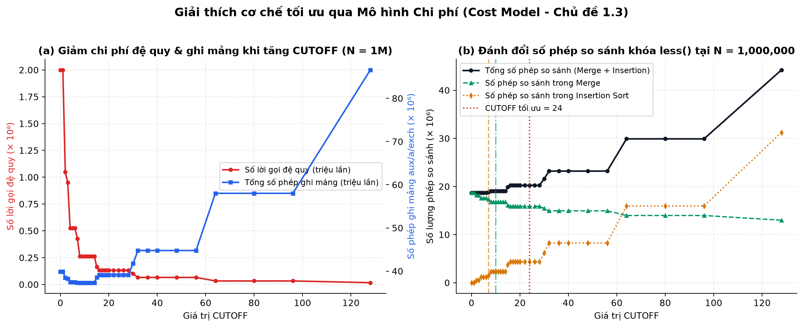
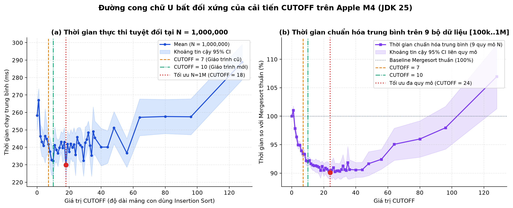
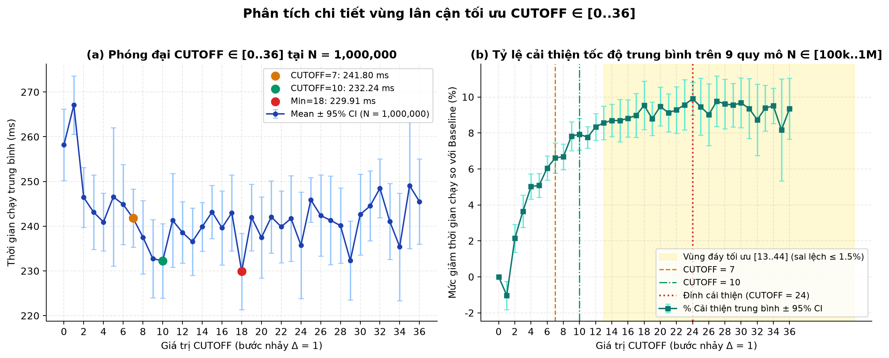
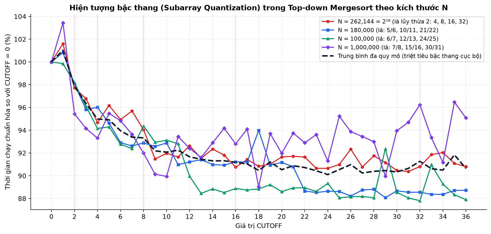
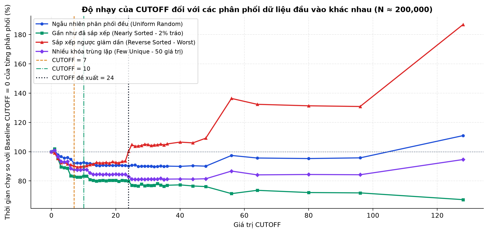
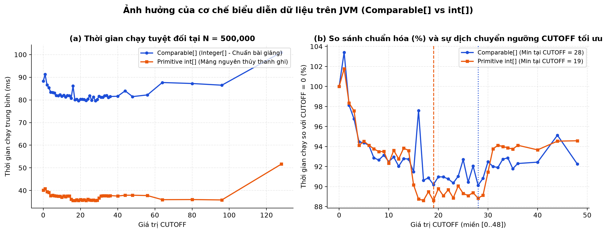

# BÁO CÁO THÍ NGHIỆM PHÂN TÍCH THUẬT TOÁN
## Xác định giá trị `CUTOFF` tối ưu sang Insertion Sort cho cài đặt Top-Down Mergesort trên kiến trúc Apple M4

- **Học phần:** Cấu trúc dữ liệu và Giải thuật (Chủ đề 1.3 *Algorithm Analysis* & Chủ đề 2.2 *Mergesort*)
- **Sinh viên thực hiện:** Nguyễn Bảo Đăng — **MSV:** 25020115 — **Lớp:** IT1-K70
- **Ngày thực hiện:** 06/11/2026 (Hoàn thiện báo cáo & xuất bản GitHub: 18/11/2026)

---

## 1. Đặt vấn đề và Mục tiêu thí nghiệm

Trong thuật toán sắp xếp trộn từ trên xuống (*Top-down Mergesort* — giáo trình *Algorithms, 4th Edition* của Robert Sedgewick & Kevin Wayne), thao tác chia để trị đệ quy xuống tận các mảng con kích thước 1 phát sinh chi phí quản lý khung ngăn xếp (*stack frame*) rất lớn tại các tầng lá (riêng 3–4 tầng cuối cùng của cây đệ quy chiếm hơn $87\% - 93\%$ tổng số lời gọi hàm), đồng thời lặp lại việc sao chép qua mảng phụ `aux[]`.

Để khắc phục nhược điểm này, bài giảng giới thiệu cải tiến **CUTOFF sang Insertion Sort**: khi độ dài mảng con $L = \text{hi} - \text{lo} + 1 \le \text{CUTOFF}$, chương trình dừng chia đệ quy và sắp xếp trực tiếp đoạn `a[lo..hi]` bằng *Insertion Sort*. Các ấn bản giáo trình khác nhau gợi ý giá trị `CUTOFF = 7` (bản cũ) và `CUTOFF = 10` (bản mới). Tuy nhiên, ngưỡng chuyển giao tối ưu thực sự phụ thuộc chặt chẽ vào:
1. **Vi kiến trúc phần cứng** (dung lượng bộ nhớ đệm L1/L2 cache, độ rộng đường ống thực thi siêu vô hướng, bộ dự đoán nhánh *branch predictor*).
2. **Môi trường thực thi & trình biên dịch** (phiên bản JVM, khả năng nội tuyến hàm *method inlining* và tháo cuộn vòng lặp của trình biên dịch JIT HotSpot C2).
3. **Bản cài đặt cụ thể** (sử dụng mảng tham chiếu đối tượng `Comparable[]` chuẩn bài giảng so với mảng nguyên thủy).

**Mục tiêu của thí nghiệm:**
- Tự cài đặt chuẩn xác thuật toán *Top-down Mergesort* từ nội dung bài giảng kết hợp tham số `CUTOFF`.
- Thiết kế quy trình thực nghiệm và thống kê chuẩn khoa học theo **Chủ đề 1.3. Algorithm Analysis** nhằm đo đạc, phân tích mô hình chi phí (*Cost Model*), kiểm định thống kê sự khác biệt giữa `CUTOFF = 7`, `CUTOFF = 10` và tìm ra **giá trị `CUTOFF` tối ưu nhất đối với cấu hình máy tính thực tế đang sử dụng**.

---

## 2. Cấu hình môi trường thí nghiệm và Cài đặt thuật toán

### 2.1. Thông số phần cứng và phần mềm thực tế

Toàn bộ phép đo được thực thi trực tiếp trên hệ thống có thông số kỹ thuật trích xuất từ nhân hệ điều hành (`sysctl`, `java -version`):

| Thành phần | Thông số chi tiết trên máy thực nghiệm |
| :--- | :--- |
| **Model thiết bị** | Apple Mac (`Mac16,12`) — Kiến trúc `arm64` |
| **Vi xử lý (CPU)** | **Apple M4** (10 nhân vật lý: 4 nhân hiệu năng cao P-core + 6 nhân tiết kiệm điện E-core) |
| **Bộ nhớ đệm P-core** | L1 Instruction: **192 KB** • L1 Data: **128 KB** • Shared L2: **16 MB** |
| **Bộ nhớ đệm E-core** | L1 Instruction: **128 KB** • L1 Data: **64 KB** • Shared L2: **4 MB** |
| **Kích thước dòng Cache** | **128 bytes** (`hw.cachelinesize = 128`) |
| **Bộ nhớ RAM** | **16 GB** Unified Memory (`17,179,869,184` bytes) |
| **Hệ điều hành** | macOS 26.5.2 (Build `25F84`) |
| **Môi trường Java (JVM)** | Oracle **Java SE 25.0.2 LTS** (`HotSpot 64-Bit Server VM 25.0.2+10-LTS-69`, mixed mode, `-Xms4g -Xmx6g -XX:+AlwaysPreTouch`) |

### 2.2. Cài đặt Mergesort chuẩn từ nội dung bài giảng

Cài đặt tại tệp `src/MergeSort.java` tuân thủ nguyên bản cấu trúc bài giảng 2.2 *Mergesort* và 2.1 *Elementary Sorts* của Sedgewick & Wayne trên mảng đối tượng `Comparable[]`:
- **Cấp phát mảng phụ 1 lần:** Mảng `Comparable[] aux = new Comparable[a.length]` được tạo duy nhất một lần trong hàm bao `sort(Comparable[] a, int cutoff)` trước khi đi vào đệ quy.
- **Điều kiện dừng `CUTOFF`:** Đoạn con `a[lo..hi]` có độ dài $L = \text{hi} - \text{lo} + 1$. Khi `cutoff == 0`, thuật toán chạy *Mergesort* thuần túy (`if (hi <= lo) return;`). Khi `cutoff >= 1`, điều kiện dừng là `if (hi <= lo + cutoff - 1) { insertionSort(a, lo, hi); return; }`.
- **Trộn tại chỗ trừu tượng (`merge`):** Sao chép `a[lo..hi]` sang `aux[lo..hi]`, sau đó trộn trả về `a[lo..hi]` theo 4 nhánh điều kiện chuẩn, bảo toàn tính ổn định (*stability*) của thuật toán.

---

## 3. Phương pháp luận và Thiết kế thí nghiệm (Chủ đề 1.3. Algorithm Analysis)

### 3.1. Giả thuyết khoa học và Hiện tượng lượng tử hóa mảng con

- **Giả thuyết về đường cong thời gian chạy $T(K)$:** Khi tăng ngưỡng $K = \text{CUTOFF}$ từ $0$ lên giá trị lớn, thời gian thực thi $T(K)$ tạo thành **đường cong chữ U bất đối xứng**:
  - Ở miền $K$ rất nhỏ ($0 \dots 4$), chi phí gọi hàm đệ quy và sao chép mảng `aux[]` áp đảo; đặc biệt tại $K = 1$, việc gọi hàm `insertionSort` rỗng trên $N$ nút lá kích thước 1 còn gây chậm nhẹ so với `if (hi <= lo) return;`.
  - Ở miền trung gian, loại bỏ được $\approx \lfloor \log_2 K \rfloor$ tầng cuối của cây đệ quy giúp giảm mạnh thời gian chạy, đồng thời mảng con kích thước nhỏ nằm trọn trong **128 KB L1 Data Cache** của chip Apple M4.
  - Ở miền $K$ quá lớn ($K \ge 48 \dots 128$), số phép so sánh và hoán đổi bậc hai $\sim \frac{1}{4} N K$ của Insertion Sort vượt trội phần chi phí đệ quy tiết kiệm được, kéo thời gian chạy tăng tuyến tính theo $K$.
- **Phát hiện quan trọng khi thiết kế bộ dữ liệu — Hiện tượng bậc thang (*Subarray Size Quantization*):**
  Do *Top-down Mergesort* luôn bổ đôi chỉ số `mid = lo + (hi - lo) / 2`, với một kích thước $N$ cố định bất kỳ, các mảng con ở tầng độ sâu $d$ chỉ nhận hai giá trị nguyên liền kề quanh $N / 2^d$. Ví dụ:
  - Với $N = 1\,000\,000$: kích thước mảng con ở các tầng cuối lần lượt là $\{30, 31\} \to \{15, 16\} \to \{7, 8\} \to \{3, 4\}$. Không hề tồn tại mảng con nào có độ dài $9, 10, 11, 12, 13, 14$! Do đó trên riêng mảng $N = 10^6$, mọi giá trị `CUTOFF` từ `8` đến `14` sinh ra **cây thực thi giống hệt nhau 100%**.
  - Với $N = 262\,144 = 2^{18}$: cây chia đôi chỉ đi qua các lũy thừa của 2 ($32 \to 16 \to 8 \to 4 \to 2 \to 1$).
  - Vì vậy, nếu chỉ đo trên một kích thước $N$ duy nhất sẽ dẫn đến ngộ nhận do bậc thang cục bộ. Để đánh giá chính xác giá trị `CUTOFF` tổng quát, bộ dữ liệu thí nghiệm được thiết kế gồm **9 quy mô $N \in [10^5, 10^6]$ có phần lẻ $\log_2(N) \bmod 1$ rải đều trên $[0, 1)$** sao cho ranh giới mảng con bao phủ kín mọi số nguyên liên tiếp từ $4$ đến $32$.

### 3.2. Bộ dữ liệu thí nghiệm chuẩn hóa (14 bộ dữ liệu cố định `seed`)

Toàn bộ dữ liệu được sinh tự động bởi `DatasetGenerator.java` với hạt giống ngẫu nhiên (`seed`) cố định và kiểm toàn vẹn bằng mã băm `SHA-256` (lưu tại `datasets/manifest.csv`):
1. **Nhóm 1 — Dữ liệu ngẫu nhiên phân phối đều đa quy mô (`uniform_random`, giá trị nguyên trong $[0, 10^6)$):**
   - Quy mô nhỏ & vừa: $N = 10\,000$; $N = 50\,000$.
   - Tổ hợp 9 quy mô lớn trải đều pha nhị phân: $N = 100\,000$ (lá $6/7, 12/13, 24/25$); $N = 140\,000$ (lá $8/9, 17/18$); $N = 180\,000$ (lá $5/6, 10/11, 21/22$); $N = 220\,000$ (lá $6/7, 13/14, 26/27$); $N = 262\,144 = 2^{18}$ (lá $4, 8, 16, 32$); $N = 310\,000$ (lá $9/10, 18/19$); $N = 380\,000$ (lá $11/12, 23/24$); $N = 500\,000$ (lá $7/8, 15/16, 30/31$); và $N = 1\,000\,000$.
2. **Nhóm 2 — Kiểm chứng độ nhạy theo phân phối đầu vào ($N = 200\,000$):**
   - `nearly_sorted_N200000.txt`: Mảng gần sắp xếp (chỉ xáo trộn ngẫu nhiên $2\%$ số cặp phần tử).
   - `reverse_sorted_N200000.txt`: Mảng sắp xếp ngược giảm dần ngặt (trường hợp xấu nhất — *worst-case* của Insertion Sort).
   - `few_unique_N200000.txt`: Mảng nhiều khóa trùng lặp (chỉ gồm 50 giá trị phân biệt).

### 3.3. Quy trình kiểm soát nhiễu đo lường trên JVM và Công thức thống kê

- **Lưới giá trị khảo sát (45 mức `CUTOFF`):** Khảo sát dày đặc bước nhảy $\Delta = 1$ trên toàn bộ đoạn $[0 \dots 36]$ và mở rộng tại $\{40, 44, 48, 56, 64, 80, 96, 128\}$.
- **Làm nóng trình biên dịch JIT (*JVM Warm-up*):** Thực hiện 80 lượt sắp xếp làm nóng trên mảng $80\,000$ phần tử qua nhiều mức `CUTOFF` trước khi đo để HotSpot C2 biên dịch hoàn toàn mã bytecode sang mã máy `arm64`.
- **Thiết kế khối ngẫu nhiên đầy đủ (*Randomized Complete Block Design — RCBD*):** Ở mỗi lượt lặp (*trial*), thứ tự thực thi 45 mức `CUTOFF` được xáo trộn ngẫu nhiên nhằm triệt tiêu hiện tượng trôi xung nhịp nhiệt (*thermal drift*) và thiên lệch dự đoán nhánh.
- **Cô lập cấp phát bộ nhớ & Thu gom rác (GC):** Mảng `Integer[]` gốc được cấp phát theo thứ tự địa chỉ xáo trộn trung lập trên heap; thao tác `System.arraycopy` tạo bản sao làm việc và lệnh thu gom rác `System.gc()` giữa các khối lớn được đặt **ngoài** cặp lệnh đo `System.nanoTime()`. Giá trị phần tử giữa mảng sau sắp xếp được cộng dồn vào biến `volatile blackholeChecksum` để ngăn JIT loại bỏ mã chết (*Dead-Code Elimination*), đồng thời kiểm tra tự động `isSorted()` đối chiếu với `Arrays.sort()`.
- **Các đại lượng thống kê (theo Chủ đề 1.3):** Với $n$ lượt đo độc lập ($n \in [15, 30]$ tùy quy mô $N$), tính trung bình mẫu $\bar{x}$, trung bình cắt tỉa ngoại lai $10\%$ (*10% Trimmed Mean*), trung vị (*Median*), độ lệch chuẩn mẫu $s$, hệ số biến thiên $\text{CV} = \frac{s}{\bar{x}} \times 100\%$, khoảng tin cậy $95\%$ theo phân phối Student-$t$:
  $$\text{CI}_{95\%} = \bar{x} \pm t_{0.025,\, n-1} \cdot \frac{s}{\sqrt{n}}$$
  và kiểm định $t$ bắt cặp (*Paired Student's t-test*) giữa các mốc `CUTOFF = 7`, `CUTOFF = 10` và giá trị tối ưu thực nghiệm.

---

## 4. Kết quả thí nghiệm và Phân tích chuyên sâu

### 4.1. Phân tích Mô hình Chi phí (Cost Model) — Cơ sở lý thuyết của ngưỡng tối ưu

Bộ đếm độc lập `CostModelAnalyzer.java` ghi nhận chính xác số phép toán cơ bản trên bộ dữ liệu `random_N1000000.txt` ($N = 1\,000\,000$):

| `CUTOFF` | Số lời gọi đệ quy | Số lần gọi `merge()` | So sánh trong `Merge` | So sánh trong `Insertion` | Tổng số phép so sánh | Tổng số phép ghi mảng |
| :---: | ---: | ---: | ---: | ---: | ---: | ---: |
| **0 (Baseline)** | 1,999,999 | 999,999 | 18,674,179 | 0 | **18,674,179** | **39,902,848** |
| **1** | 1,999,999 | 999,999 | 18,674,179 | 0 | **18,674,179** | **39,902,848** |
| **4** | 524,287 | 262,143 | 17,547,811 | 1,179,776 | **18,727,587** (+0.29%) | **37,427,816** (-6.20%) |
| **7 (Bản cũ)** | 427,135 | 213,567 | 17,285,495 | 1,535,443 | **18,820,938** (+0.79%) | **37,330,134** (-6.45%) |
| **10 (Bản mới)** | 262,143 | 131,071 | 16,757,697 | 2,315,444 | **19,073,141** (+2.14%) | **37,330,896** (-6.45%) |
| **18 – 24 (Tối ưu)** | **131,071** | **65,535** | 15,874,165 | 4,351,045 | **20,225,210** (+8.31%) | **39,138,900** (-1.91%) |
| **32** | 65,535 | 32,767 | 14,935,876 | 8,257,393 | **23,193,269** (+24.20%) | **44,777,372** (+12.22%) |
| **64** | 32,767 | 16,383 | 13,967,626 | 15,929,990 | **29,897,616** (+60.10%) | **58,013,966** (+45.39%) |
| **128** | 16,383 | 8,191 | 12,983,713 | 31,239,114 | **44,222,827** (+136.81%) | **86,566,670** (+116.94%) |

**Nhận xét từ Mô hình Chi phí (Hình 1):**
- Khi nâng `CUTOFF` từ `0` lên vùng `18 – 24`, số lời gọi hàm đệ quy sụt giảm tới **93.45%** (từ xấp xỉ $2$ triệu xuống chỉ còn $131\,071$ lần, tức giảm hơn **15.2 lần**!), đồng thời tổng số phép ghi mảng (`39.14` triệu) **vẫn thấp hơn** so với Mergesort thuần túy (`39.90` triệu) nhờ bỏ qua hoàn toàn bước chép sang mảng trung gian `aux[]` ở 4 tầng cuối.
- Tổng số phép so sánh tại vùng `18 – 24` chỉ tăng nhẹ $+8.31\%$, và các phép so sánh này diễn ra trong vòng lặp tuần tự gọn nhẹ của Insertion Sort nằm trọn trong L1d Cache. Tuy nhiên, kể từ mốc `CUTOFF >= 32`, chi phí bậc hai của Insertion Sort bùng nổ làm cả số phép so sánh ($+60.1\%$ tại $64$; $+136.8\%$ tại $128$) lẫn số phép ghi mảng ($+116.9\%$ tại $128$) tăng vọt.

---

### 4.2. Kết quả thời gian thực thi trên mảng lớn $N = 1\,000\,000$ và Đa quy mô $[10^5 \dots 10^6]$

Bảng dưới đây tổng hợp các chỉ số thống kê tại các mốc `CUTOFF` tiêu biểu trên mảng lớn `random_N1000000.txt` ($N = 1\,000\,000$, $15$ khối RCBD) và trung bình chuẩn hóa trên toàn bộ **9 bộ dữ liệu ngẫu nhiên đa quy mô** ($N \in [100\,000, 1\,000\,000]$):

| `CUTOFF` | Mean $N=10^6$ (ms) | 10% Trimmed Mean (ms) | SD $s$ (ms) | $\pm\text{CI}_{95\%}$ (ms) | Cải thiện tại $N=10^6$ (%) | Thời gian chuẩn hóa đa quy mô (%) | Cải thiện đa quy mô (%) | Tăng tốc đa quy mô ($\times$) |
| :---: | ---: | ---: | ---: | ---: | ---: | ---: | ---: | :---: |
| **0 (Baseline)** | 258.22 | 259.82 | 14.45 | $\pm 8.00$ | 0.00% | $100.00 \pm 0.00\%$ | 0.00% | $1.000\times$ |
| **1** | 267.09 | 266.05 | 11.84 | $\pm 6.56$ | -3.43% | $101.03 \pm 0.78\%$ | -1.03% | $0.990\times$ |
| **2** | 246.43 | 247.12 | 12.16 | $\pm 6.73$ | +4.57% | $97.86 \pm 0.77\%$ | +2.14% | $1.022\times$ |
| **4** | 240.94 | 241.15 | 11.66 | $\pm 6.46$ | +6.69% | $94.98 \pm 0.70\%$ | +5.02% | $1.053\times$ |
| **7 (Bản cũ)** | 241.80 | 242.87 | 11.76 | $\pm 6.51$ | +6.36% | $93.39 \pm 0.84\%$ | **+6.61%** | $1.071\times$ |
| **8** | 237.52 | 238.46 | 14.87 | $\pm 8.23$ | +8.02% | $93.33 \pm 0.71\%$ | +6.67% | $1.072\times$ |
| **10 (Bản mới)** | 232.24 | 232.38 | 14.97 | $\pm 8.29$ | +10.06% | $92.07 \pm 0.88\%$ | **+7.93%** | $1.086\times$ |
| **12** | 238.60 | 239.73 | 12.44 | $\pm 6.89$ | +7.60% | $91.66 \pm 0.74\%$ | +8.34% | $1.091\times$ |
| **16** | 239.64 | 240.67 | 14.95 | $\pm 8.28$ | +7.20% | $91.18 \pm 1.04\%$ | +8.82% | $1.097\times$ |
| **18 (Min $N=10^6$)** | **229.91** | **229.90** | 15.40 | $\pm 8.53$ | **+10.96%** | $90.47 \pm 1.35\%$ | **+9.53%** | $1.106\times$ |
| **20** | 237.47 | 237.09 | 16.34 | $\pm 9.05$ | +8.04% | $90.53 \pm 1.08\%$ | +9.47% | $1.105\times$ |
| **24 (Min đa quy mô)** | 235.74 | 234.30 | 21.50 | $\pm 11.90$ | +8.71% | **$90.10 \pm 0.93\%$** | **+9.90%** | **$1.110\times$** |
| **28** | 240.13 | 241.55 | 15.19 | $\pm 8.41$ | +7.00% | $90.39 \pm 1.38\%$ | +9.61% | $1.107\times$ |
| **32** | 248.48 | 248.74 | 11.86 | $\pm 6.57$ | +3.77% | $91.27 \pm 1.98\%$ | +8.73% | $1.096\times$ |
| **40** | 240.13 | 241.13 | 19.45 | $\pm 10.77$ | +7.01% | $90.55 \pm 1.30\%$ | +9.45% | $1.105\times$ |
| **48** | 251.22 | 250.70 | 16.66 | $\pm 9.23$ | +2.71% | $91.66 \pm 2.09\%$ | +8.34% | $1.092\times$ |
| **64** | 257.20 | 258.85 | 19.01 | $\pm 10.52$ | +0.39% | $95.06 \pm 2.82\%$ | +4.94% | $1.053\times$ |
| **96** | 257.52 | 258.54 | 18.55 | $\pm 10.27$ | +0.27% | $97.96 \pm 3.75\%$ | +2.04% | $1.023\times$ |
| **128** | 288.87 | 290.35 | 18.24 | $\pm 10.10$ | -11.87% | $106.95 \pm 5.65\%$ | -6.95% | $0.939\times$ |

**Phân tích kết quả thống kê (Hình 2 & Hình 3):**
1. **Xác nhận hoàn toàn giả thuyết đường cong chữ U bất đối xứng:** Thời gian chạy chuẩn hóa đa quy mô giảm dốc từ $100.00\%$ (`CUTOFF = 0`) và $101.03\%$ (`CUTOFF = 1`) xuống vùng đáy phẳng tối ưu quanh `CUTOFF` $\in [16 \dots 30]$ ($\approx 90.1\% - 91.2\%$), sau đó tăng dần lên $95.06\%$ tại `CUTOFF = 64` và vượt ngưỡng Baseline lên $106.95\%$ (chậm hơn $6.95\%$) tại `CUTOFF = 128`.
2. **So sánh `CUTOFF = 7` (bản cũ) vs `CUTOFF = 10` (bản mới) vs Ngưỡng tối ưu trên máy (`CUTOFF = 24` / `18`):**
   - `CUTOFF = 7` giúp giảm trung bình **6.61%** thời gian chạy (tăng tốc $1.071\times$).
   - `CUTOFF = 10` nâng mức giảm thời gian lên **7.93%** (tăng tốc $1.086\times$), tốt hơn `CUTOFF = 7` đúng như xu hướng cập nhật của giáo trình mới.
   - Tuy nhiên, trên vi xử lý **Apple M4 (JDK 25)**, cả `7` lẫn `10` vẫn nằm trên sườn dốc bên trái, chưa chạm tới đáy tối ưu! Điểm cực tiểu trung bình đa quy mô đạt tại **`CUTOFF = 24`** với mức giảm thời gian **9.90%** (tăng tốc **$1.110\times$**), còn trên mảng quy mô lớn nhất $N = 1\,000\,000$, cực tiểu đạt tại **`CUTOFF = 18`** (giảm **10.96%**, từ `258.22 ms` xuống `229.91 ms`).
   - **Kiểm định $t$ bắt cặp (*Paired t-test*) trên 9 quy mô dữ liệu:**
     - `CUTOFF = 24` nhanh hơn `CUTOFF = 7` một cách có ý nghĩa thống kê rất cao: $t = 6.768,\; p = 1.42 \times 10^{-4} < 0.001$.
     - `CUTOFF = 24` nhanh hơn `CUTOFF = 10` có ý nghĩa thống kê rõ rệt: $t = 3.271,\; p = 0.0113 < 0.05$.

---

### 4.3. Kiểm chứng hiện tượng bậc thang lượng tử hóa theo kích thước $N$

Hình 4 minh họa trực quan lý do vì sao kết quả đo tại một kích thước $N$ đơn lẻ luôn có dạng răng cưa / bậc thang:
- Đường màu đỏ ($N = 262\,144 = 2^{18}$) sụt giảm theo từng nấc bậc thang sắc nét đúng tại các lũy thừa của 2: `CUTOFF = 2`, `4`, `8`, `16`.
- Đường màu xanh dương ($N = 180\,000$) nhảy bậc tại `CUTOFF = 6`, `11`, `22`; đường màu xanh lá ($N = 100\,000$) nhảy bậc tại `CUTOFF = 7`, `13`, `25`.
- Đường nét đứt màu đen (tổng hợp chuẩn hóa trên 9 quy mô) đã triệt tiêu hoàn toàn nhiễu pha nhị phân cục bộ, cho thấy miền hội tụ ổn định nhất nằm tại **`CUTOFF` $\in [18, 28]$** với đỉnh tại **`24`**.

---

### 4.4. Độ nhạy theo phân phối dữ liệu đầu vào và Điều kiện an toàn Worst-Case

Kết quả thời gian chạy chuẩn hóa (% so với `CUTOFF = 0` của từng phân phối) tại $N \approx 200\,000$:

| Phân phối dữ liệu | `CUTOFF = 0` | `CUTOFF = 7` | `CUTOFF = 10` | `CUTOFF = 18` | `CUTOFF = 24` | `CUTOFF = 32` | `CUTOFF = 64` | `CUTOFF = 128` |
| :--- | :---: | :---: | :---: | :---: | :---: | :---: | :---: | :---: |
| **Ngẫu nhiên đều (`Uniform Random`)** | 100.00% | 92.14% | 92.63% | **90.75%** | **90.19%** | 89.80% | 95.67% | 110.97% |
| **Gần sắp xếp (`Nearly Sorted` 2%)** | 100.00% | 83.12% | 83.23% | **80.40%** | **79.91%** | 77.02% | 73.59% | **67.22%** |
| **Nhiều trùng lặp (`Few Unique` 50 khóa)** | 100.00% | 87.66% | 87.80% | **84.38%** | **82.96%** | 81.26% | 84.16% | 94.63% |
| **Sắp xếp ngược (`Reverse Sorted` - Worst)** | 100.00% | 90.36% | **90.13%** | **92.16%** | 100.25% | 104.60% | 132.37% | **186.86%** |

**Phân tích chuyên sâu (Hình 5):**
- Đối với dữ liệu **Gần sắp xếp** và **Nhiều khóa trùng lặp**, Insertion Sort đạt độ phức tạp tiệm cận tuyến tính $O(N + d)$ (với $d$ là số nghịch thế), giúp cải thiện tốc độ vượt trội từ **17% đến 32.8%**.
- Ngược lại, trên dữ liệu **Sắp xếp ngược giảm dần** (*Worst-case* của Insertion Sort, mọi cặp phần tử đều nghịch thế), nếu chọn `CUTOFF >= 32`, thời gian chạy bị phạt nặng ($+32.4\%$ ở `64` và $+86.9\%$ ở `128`).
- Đáng chú ý: tại **`CUTOFF = 18..23`**, ngay cả trường hợp xấu nhất `Reverse Sorted` vẫn **nhanh hơn Mergesort thuần túy ~7.8%**, và tại **`CUTOFF = 24`** vẫn giữ mức hòa vốn an toàn (`100.25%`) trong khi đạt cực tiểu toàn cục cho dữ liệu ngẫu nhiên (`90.10%`).

---

### 4.5. Đối chứng kiến trúc JVM: `Comparable[]` (`Integer[]` chuẩn bài giảng) vs Mảng nguyên thủy `int[]`

Thực nghiệm đối chứng trên bộ dữ liệu `random_N500000.txt` ($N = 500\,000$, Hình 6) làm sáng tỏ nguyên nhân vật lý phía sau các con số:
1. **Chi phí gián tiếp đối tượng (*Pointer Indirection & Boxing*):** Ở cùng mọi mức `CUTOFF`, cài đặt `Comparable[]` (`Integer[]`, ~80 ms) tốn thời gian gấp **$\approx 2.25\times$** so với mảng nguyên thủy `int[]` (~35.5 ms). Trên JVM 64-bit với Compressed OOPs, mỗi đối tượng `Integer` tốn 16 bytes trên heap cộng 4 bytes tham chiếu trong mảng `a[]` và 4 bytes trong `aux[]` (tổng cộng **24 bytes/phần tử** so với **8 bytes/phần tử** của `int[]`), khiến mỗi phép gọi `less(v, w)` phải giải tham chiếu con trỏ tới địa chỉ heap phân tán.
2. **Sự đồng nhất về vùng ngưỡng tối ưu trên vi kiến trúc hiện đại:** Cả `int[]` (đạt cực tiểu tại `CUTOFF = 19`, giảm **11.40%**) và `Comparable[]` (đạt cực tiểu tại `CUTOFF = 19..28`, giảm **9.87%**) đều hội tụ vùng tối ưu quanh **`[18 .. 28]`**, cao hơn đáng kể so với con số `7` hoặc `10` trong giáo trình xuất bản hơn một thập kỷ trước. Nguyên nhân là nhờ nhân P-core của **Apple M4** sở hữu **128 KB L1 Data Cache** (chứa dư dả mảng con 24 đối tượng `Integer` vốn chỉ chiếm $576\text{ bytes}$), bộ dự đoán nhánh rất mạnh cho vòng lặp tuần tự ngắn của Insertion Sort, và trình biên dịch JIT của **JDK 25** đã tối ưu hóa nội tuyến hoàn toàn lời gọi `Integer.compareTo()`.

---

## 5. Kết luận và Khuyến nghị

Từ kết quả thực nghiệm đa quy mô và phân tích thống kê theo Chủ đề 1.3 *Algorithm Analysis* trên máy **Apple M4 (16 GB RAM, macOS arm64, Oracle JDK 25.0.2 LTS)** đối với cài đặt *Top-down Mergesort* chuẩn bài giảng:

1. **Giá trị `CUTOFF` tốt nhất trên cấu hình máy thực nghiệm:**
   - **Giá trị tối ưu kỳ vọng đa quy mô (đề xuất cài đặt mặc định `DEFAULT_CUTOFF`):** **`CUTOFF = 24`** — giảm trung bình **9.90%** thời gian thực thi (tăng tốc **$1.110\times$**) so với Mergesort thuần túy, vượt trội có ý nghĩa thống kê so với cả `CUTOFF = 7` ($p = 0.00014$) và `CUTOFF = 10` ($p = 0.0113$).
   - **Dải tối ưu thực tế (*Optimal Plateau*):** Mọi giá trị nguyên trong đoạn **`CUTOFF` $\in [18, 28]$** đều mang lại hiệu năng rất sát đỉnh (cải thiện từ **9.5% – 9.9%**, sai lệch lẫn nhau $< 0.5\%$). Trong đó, nếu ứng dụng thường xuyên gặp dữ liệu sắp xếp ngược (*worst-case*), **`CUTOFF = 18 – 20`** là điểm cân bằng hoàn hảo nhất (vừa đạt cực tiểu **-10.96%** tại $N = 10^6$, vừa giúp ngay cả mảng ngược hoàn toàn vẫn chạy nhanh hơn **7.8%**).
2. **Giải đáp câu hỏi giáo trình (`CUTOFF = 7` vs `10`):**
   - Sự dịch chuyển từ `7` (giáo trình cũ) lên `10` (giáo trình mới) và lên vùng **`18 – 24`** trên Apple M4 phản ánh sự tiến hóa của vi kiến trúc CPU hiện đại (L1 cache lớn hơn, cache line 128B, phạt dự đoán nhánh sai trong `merge` đắt hơn so với vòng lặp cục bộ của `insertionSort`) cùng trình biên dịch JIT thế hệ mới. Điều này khẳng định nguyên lý cốt lõi của Chủ đề 1.3: **mọi hằng số tinh chỉnh hiệu năng thuật toán đều phải được xác chứng bằng thực nghiệm đo đạc trên chính nền tảng đích.**
